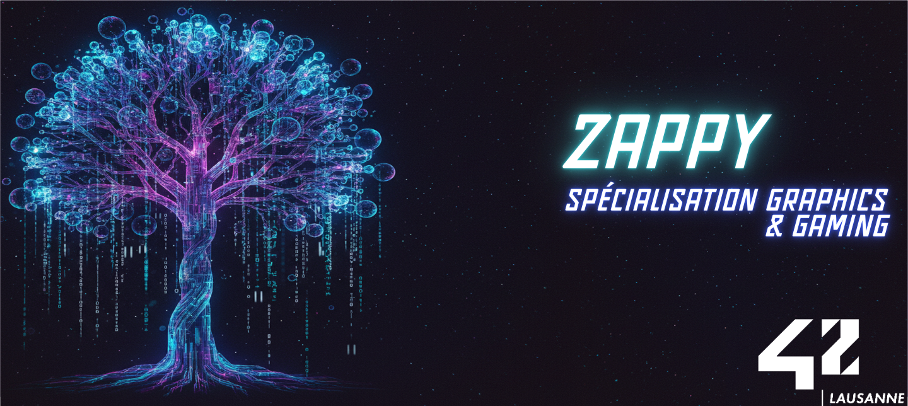
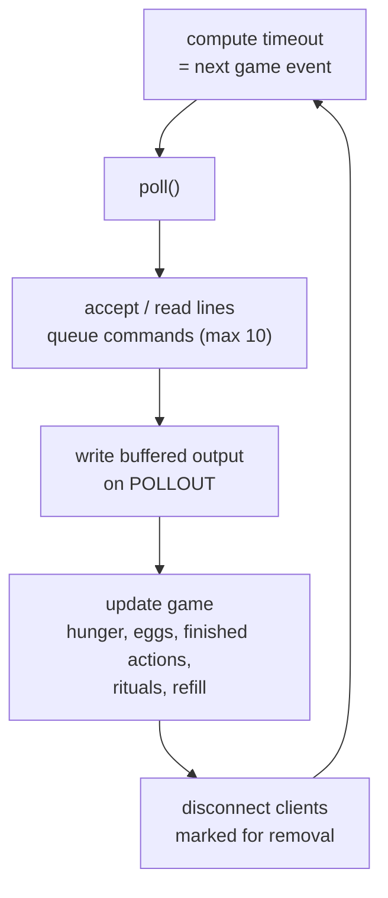
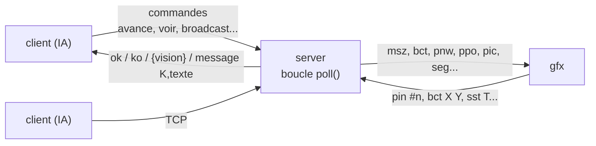
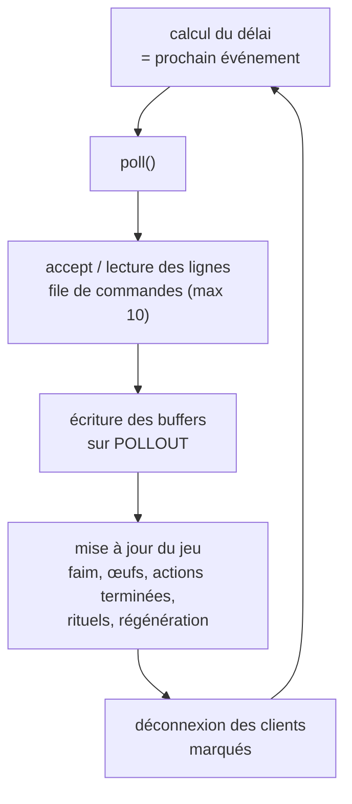

<div align="center">

# Zappy
### A networked game where autonomous AIs compete, with a real-time graphical monitor.

[![Contributors][contributors-shield]][contributors-url]
[![Forks][forks-shield]][forks-url]
[![Stargazers][stars-shield]][stars-url]
[![Issues][issues-shield]][issues-url]
[![License][license-shield]][license-url]
[![LinkedIn][linkedin-shield]][linkedin-url]

</div>

---

## 🇬🇧 English

<details>
<summary><b>📖 Click to expand/collapse English version</b></summary>

### 📋 Table of Contents

- [About](#about)
- [Skills Learned](#skills-learned)
- [Approach](#approach)
- [Project Structure](#project-structure)
- [Installation](#installation)
- [Usage](#usage)
- [Tests](#tests)
- [Credits](#credits)

---

<a name="about"></a>

### 📖 About

Zappy is a game played by programs. On Trantor, a round world without relief, teams of players controlled by AIs gather food to survive and stones to perform elevation rituals. The first team to bring 6 of its players to level 8 wins.

The project is made of three programs:

| Program | Language | Role |
|---------|----------|------|
| `server` | C++11 | Owns the world, the timing and the rules. One process, one thread, blocking sockets multiplexed with `poll()`. |
| `client` | Python 3 | Autonomous AI driving one player: feeds itself, collects stones, gathers teammates by broadcast, forks new players. |
| `gfx` | Python 3 (tkinter) | Real-time 2D view of the game, following the server/monitor protocol (`protocol-gfx.pdf`). |

---

<a name="skills-learned"></a>

### 🧠 Skills Learned

- Writing a single-threaded TCP server that serves many clients with `poll()`, without threads nor non-blocking sockets.
- Scheduling timed actions on an absolute clock (`steady_clock`) without active waiting: `poll()` sleeps until the next game event.
- Buffering input and output per client, and protecting the server against slow or malicious clients.
- Implementing a text protocol to the letter (player commands and graphical monitor protocol).
- Geometry on a torus: field of view, shortest path of a sound and its direction relative to the listener.
- Designing a cooperative AI that only communicates through the game (broadcasts).
- Building an event-driven graphical client (Tk event loop watching the socket).
- Testing a networked program end to end (106 automated tests).

---

<a name="approach"></a>

### 🗺️ Approach

**Architecture**


**Main loop of the server**

Every client is watched by a single `poll()`. Its timeout is the time left before the next game event (end of an action, death, egg hatching, end of a ritual, resource refill), so the server sleeps instead of spinning. Outgoing data is buffered and only written when `poll()` reports the socket writable.



**Time**

A time unit lasts `1/t` seconds. Every deadline is an absolute point in time: a command is executed when its delay is over, a player dies when its life time is reached (one `nourriture` = 126 time units, 10 at start).

| Command | Delay | Answer |
|---------|-------|--------|
| `avance`, `droite`, `gauche`, `voir` | 7/t | `ok` / `{case0, case1, ...}` |
| `inventaire` | 1/t | `{nourriture n, linemate n, ...}` |
| `prend <obj>`, `pose <obj>`, `expulse` | 7/t | `ok` / `ko` |
| `broadcast <text>` | 7/t | `ok` |
| `incantation` | 300/t | `elevation en cours` then `niveau actuel : K` |
| `fork` | 42/t | `ok` (the egg hatches after 600/t) |
| `connect_nbr` | 0/t | number of free slots of the team |

**Sound direction**

The server takes the shortest vector between emitter and listener on the torus, then turns it into the listener's frame: square `1` is in front, then counter-clockwise up to `8`; `0` means the same square.

**Graphical monitor**

The `gfx` connects with `GRAPHIC` and receives the whole state (`msz`, `sgt`, `bct`, `tna`, `pnw`, `enw`), then every event. Player and egg numbers are written `#n`. It can also query the server (`msz`, `bct`, `mct`, `tna`, `ppo`, `plv`, `pin`, `sgt`) and change the game speed with `sst`.

---

<a name="project-structure"></a>

### 📂 Project Structure

```
42-zappy/
├── includes/
│   ├── Server.hpp          # Server class, eggs, rituals, graphic protocol
│   ├── Player.hpp          # Client state: buffers, command queue, inventory, timers
│   ├── World.hpp           # Torus map and resource generation
│   └── Utils.hpp           # Usage message, argument helpers
├── srcs/
│   ├── server/main.cpp     # Argument parsing, signals, entry point
│   ├── core/Server.cpp     # poll() loop, commands, game rules, monitor protocol
│   ├── core/Player.cpp     # Line buffering and command queue
│   ├── client/client.py    # Autonomous AI client
│   └── gfx/gfx.py          # tkinter graphical monitor
├── tests/
│   ├── run_tests.sh        # Builds and runs the test battery
│   ├── test_suite.py       # 106 tests, organised by section of the subject
│   ├── zappy_testlib.py    # Test helpers: server process, player, graphic observer
│   └── test_zappy.py       # Standalone smoke test script
├── readme/zappy.png        # Header image
├── Makefile
└── LICENSE
```

---

<a name="installation"></a>

### 🚀 Installation

**Prerequisites**

- A C++11 compiler (`c++`) and `make`
- Python 3
- tkinter for the graphical monitor (`apt install python3-tk` or `pacman -S tk`)

```bash
git clone https://github.com/HaruSnak/42-zappy.git
cd 42-zappy
make
```

The Makefile builds `server` and installs `client` and `gfx` as executables. Rules: `all`, `server`, `client`, `gfx`, `clean`, `fclean`, `re`.

---

<a name="usage"></a>

### 💻 Usage

**Server**
```bash
./server -p <port> -x <width> -y <height> -n <team> [<team>] ... -c <nb> -t <t>
./server -p 4242 -x 20 -y 15 -n red blue -c 6 -t 100
```

| Flag | Meaning |
|------|---------|
| `-p` | Port |
| `-x` / `-y` | World width / height |
| `-n` | Team names |
| `-c` | Number of clients authorized per team at the start |
| `-t` | Time unit divider (default `100`): the greater, the faster |

**AI client**
```bash
./client -n <team> -p <port> [-h <hostname>]
./client -n red -p 4242
```

The client plays alone. It forks and launches new clients on hatched eggs until its team has 6 players.

**Graphical monitor**
```bash
./gfx -p <port> [-h <hostname>]
./gfx -p 4242
```

| Input | Action |
|-------|--------|
| Click on a square | Shows its resources, eggs and players |
| `+` / `-` | Doubles / halves the game speed (`sst`) |
| `m` | Mutes / unmutes the broadcast sound |

**A full game**
```bash
./server -p 4242 -x 15 -y 15 -n red blue -c 2 -t 100 &
./gfx -p 4242 &
./client -n red -p 4242 & ./client -n red -p 4242 &
./client -n blue -p 4242 & ./client -n blue -p 4242 &
```

---

<a name="tests"></a>

### 🧪 Tests

```bash
./tests/run_tests.sh                        # everything (~2 min)
ZAPPY_SKIP_SLOW=1 ./tests/run_tests.sh      # without the long end-to-end games
./tests/run_tests.sh -k Broadcast           # only the matching tests
```

The battery covers argument parsing, the connection, every command and its delay, hunger, vision, sound direction, kick, rituals, reproduction, the 10 pending requests limit, robustness (disconnections, huge lines, many clients), the graphical protocol, a scripted victory, the AI client and the graphical client.

---

<a name="credits"></a>

### 📖 Credits

- **42 School** — subject and graphical protocol
- **`poll(2)`**: [man7.org/linux/man-pages/man2/poll.2.html](https://man7.org/linux/man-pages/man2/poll.2.html)
- **Tkinter documentation**: [docs.python.org/3/library/tkinter.html](https://docs.python.org/3/library/tkinter.html)

### 📄 License

This project is licensed under the **MIT License** — see the [LICENSE](LICENSE) file for details.

</details>

---

## 🇫🇷 Français

<details>
<summary><b>📖 Cliquez pour développer/réduire la version française</b></summary>

### 📋 Table des matières

- [À propos](#à-propos)
- [Compétences acquises](#compétences-acquises)
- [Approche](#approche-fr)
- [Structure du projet](#structure-du-projet)
- [Installation](#installation-fr)
- [Utilisation](#utilisation)
- [Tests](#tests-fr)
- [Crédits](#crédits)

---

<a name="à-propos"></a>

### 📖 À propos

Zappy est un jeu joué par des programmes. Sur Trantor, un monde rond et sans relief, des équipes de joueurs pilotés par des IA ramassent de la nourriture pour survivre et des pierres pour accomplir des rituels d'élévation. La première équipe qui amène 6 de ses joueurs au niveau 8 gagne.

Le projet se compose de trois programmes :

| Programme | Langage | Rôle |
|-----------|---------|------|
| `server` | C++11 | Gère le monde, le temps et les règles. Un processus, un thread, des sockets bloquantes multiplexées avec `poll()`. |
| `client` | Python 3 | IA autonome qui pilote un joueur : se nourrit, ramasse les pierres, rassemble ses coéquipiers par broadcast, pond de nouveaux joueurs. |
| `gfx` | Python 3 (tkinter) | Vue 2D du jeu en temps réel, qui suit le protocole serveur/moniteur (`protocol-gfx.pdf`). |

---

<a name="compétences-acquises"></a>

### 🧠 Compétences acquises

- Écrire un serveur TCP mono-thread qui sert de nombreux clients avec `poll()`, sans threads ni sockets non bloquantes.
- Planifier des actions temporisées sur une horloge absolue (`steady_clock`) sans attente active : `poll()` dort jusqu'au prochain événement du jeu.
- Bufferiser les entrées et sorties de chaque client, et protéger le serveur des clients lents ou malveillants.
- Implémenter un protocole texte à la lettre (commandes des joueurs et protocole du moniteur graphique).
- Faire de la géométrie sur un tore : champ de vision, plus court chemin d'un son et sa direction par rapport à l'auditeur.
- Concevoir une IA coopérative qui ne communique qu'à travers le jeu (broadcasts).
- Construire un client graphique événementiel (la boucle Tk surveille la socket).
- Tester un programme réseau de bout en bout (106 tests automatisés).

---

<a name="approche-fr"></a>

### 🗺️ Approche

**Architecture**



**Boucle principale du serveur**

Tous les clients sont surveillés par un seul `poll()`. Son délai est le temps restant avant le prochain événement du jeu (fin d'une action, mort, éclosion, fin d'un rituel, régénération des ressources) : le serveur dort au lieu de tourner à vide. Les données sortantes sont bufferisées et écrites seulement quand `poll()` signale la socket prête en écriture.



**Le temps**

Une unité de temps dure `1/t` seconde. Chaque échéance est un instant absolu : une commande s'exécute quand son délai est écoulé, un joueur meurt quand sa durée de vie est atteinte (une `nourriture` = 126 unités de temps, 10 au départ).

| Commande | Délai | Réponse |
|----------|-------|---------|
| `avance`, `droite`, `gauche`, `voir` | 7/t | `ok` / `{case0, case1, ...}` |
| `inventaire` | 1/t | `{nourriture n, linemate n, ...}` |
| `prend <objet>`, `pose <objet>`, `expulse` | 7/t | `ok` / `ko` |
| `broadcast <texte>` | 7/t | `ok` |
| `incantation` | 300/t | `elevation en cours` puis `niveau actuel : K` |
| `fork` | 42/t | `ok` (l'œuf éclot après 600/t) |
| `connect_nbr` | 0/t | nombre de places libres de l'équipe |

**Direction du son**

Le serveur prend le plus court vecteur entre l'émetteur et l'auditeur sur le tore, puis le ramène dans le repère de l'auditeur : la case `1` est devant, puis on tourne dans le sens anti-horaire jusqu'à `8` ; `0` signifie la même case.

**Moniteur graphique**

Le `gfx` se connecte avec `GRAPHIC` et reçoit tout l'état (`msz`, `sgt`, `bct`, `tna`, `pnw`, `enw`), puis chaque événement. Les numéros de joueurs et d'œufs s'écrivent `#n`. Il peut aussi interroger le serveur (`msz`, `bct`, `mct`, `tna`, `ppo`, `plv`, `pin`, `sgt`) et changer la vitesse du jeu avec `sst`.

---

<a name="structure-du-projet"></a>

### 📂 Structure du projet

```
42-zappy/
├── includes/
│   ├── Server.hpp          # Classe Server, œufs, rituels, protocole graphique
│   ├── Player.hpp          # État d'un client : buffers, file de commandes, inventaire, timers
│   ├── World.hpp           # Carte torique et génération des ressources
│   └── Utils.hpp           # Message d'usage, aides au parsing des arguments
├── srcs/
│   ├── server/main.cpp     # Parsing des arguments, signaux, point d'entrée
│   ├── core/Server.cpp     # Boucle poll(), commandes, règles du jeu, protocole moniteur
│   ├── core/Player.cpp     # Découpage en lignes et file de commandes
│   ├── client/client.py    # Client IA autonome
│   └── gfx/gfx.py          # Moniteur graphique tkinter
├── tests/
│   ├── run_tests.sh        # Compile et lance la batterie de tests
│   ├── test_suite.py       # 106 tests, organisés par section du sujet
│   ├── zappy_testlib.py    # Aides : processus serveur, joueur, observateur graphique
│   └── test_zappy.py       # Script de test rapide autonome
├── readme/zappy.png        # Image d'en-tête
├── Makefile
└── LICENSE
```

---

<a name="installation-fr"></a>

### 🚀 Installation

**Prérequis**

- Un compilateur C++11 (`c++`) et `make`
- Python 3
- tkinter pour le moniteur graphique (`apt install python3-tk` ou `pacman -S tk`)

```bash
git clone https://github.com/HaruSnak/42-zappy.git
cd 42-zappy
make
```

Le Makefile compile `server` et installe `client` et `gfx` comme exécutables. Règles : `all`, `server`, `client`, `gfx`, `clean`, `fclean`, `re`.

---

<a name="utilisation"></a>

### 💻 Utilisation

**Serveur**
```bash
./server -p <port> -x <width> -y <height> -n <team> [<team>] ... -c <nb> -t <t>
./server -p 4242 -x 20 -y 15 -n red blue -c 6 -t 100
```

| Option | Signification |
|--------|---------------|
| `-p` | Port |
| `-x` / `-y` | Largeur / hauteur du monde |
| `-n` | Noms des équipes |
| `-c` | Nombre de clients autorisés par équipe au départ |
| `-t` | Diviseur de l'unité de temps (`100` par défaut) : plus il est grand, plus le jeu va vite |

**Client IA**
```bash
./client -n <team> -p <port> [-h <hostname>]
./client -n red -p 4242
```

Le client joue seul. Il pond et lance de nouveaux clients sur les œufs éclos jusqu'à ce que son équipe compte 6 joueurs.

**Moniteur graphique**
```bash
./gfx -p <port> [-h <hostname>]
./gfx -p 4242
```

| Entrée | Action |
|--------|--------|
| Clic sur une case | Affiche ses ressources, ses œufs et ses joueurs |
| `+` / `-` | Double / divise par deux la vitesse du jeu (`sst`) |
| `m` | Coupe / remet le son des broadcasts |

**Une partie complète**
```bash
./server -p 4242 -x 15 -y 15 -n red blue -c 2 -t 100 &
./gfx -p 4242 &
./client -n red -p 4242 & ./client -n red -p 4242 &
./client -n blue -p 4242 & ./client -n blue -p 4242 &
```

---

<a name="tests-fr"></a>

### 🧪 Tests

```bash
./tests/run_tests.sh                        # tout (~2 min)
ZAPPY_SKIP_SLOW=1 ./tests/run_tests.sh      # sans les longues parties de bout en bout
./tests/run_tests.sh -k Broadcast           # seulement les tests correspondants
```

La batterie couvre le parsing des arguments, la connexion, chaque commande et son délai, la faim, la vision, la direction du son, l'expulsion, les rituels, la reproduction, la limite de 10 requêtes en attente, la robustesse (déconnexions, lignes énormes, nombreux clients), le protocole graphique, une victoire scriptée, le client IA et le client graphique.

---

<a name="crédits"></a>

### 📖 Crédits

- **42 School** — sujet et protocole graphique
- **`poll(2)`** : [man7.org/linux/man-pages/man2/poll.2.html](https://man7.org/linux/man-pages/man2/poll.2.html)
- **Documentation Tkinter** : [docs.python.org/3/library/tkinter.html](https://docs.python.org/3/library/tkinter.html)

### 📄 Licence

Ce projet est sous licence **MIT** — voir le fichier [LICENSE](LICENSE) pour plus de détails.

</details>

---

[contributors-shield]: https://img.shields.io/github/contributors/HaruSnak/42-zappy.svg?style=for-the-badge
[contributors-url]: https://github.com/HaruSnak/42-zappy/graphs/contributors
[forks-shield]: https://img.shields.io/github/forks/HaruSnak/42-zappy.svg?style=for-the-badge
[forks-url]: https://github.com/HaruSnak/42-zappy/network/members
[stars-shield]: https://img.shields.io/github/stars/HaruSnak/42-zappy.svg?style=for-the-badge
[stars-url]: https://github.com/HaruSnak/42-zappy/stargazers
[issues-shield]: https://img.shields.io/github/issues/HaruSnak/42-zappy.svg?style=for-the-badge
[issues-url]: https://github.com/HaruSnak/42-zappy/issues
[linkedin-shield]: https://img.shields.io/badge/-LinkedIn-black.svg?style=for-the-badge&logo=linkedin&colorB=555
[linkedin-url]: https://www.linkedin.com/in/shany-moreno-5a863b2aa
[license-shield]: https://img.shields.io/github/license/HaruSnak/42-zappy.svg?style=for-the-badge
[license-url]: https://github.com/HaruSnak/42-zappy/blob/main/LICENSE
